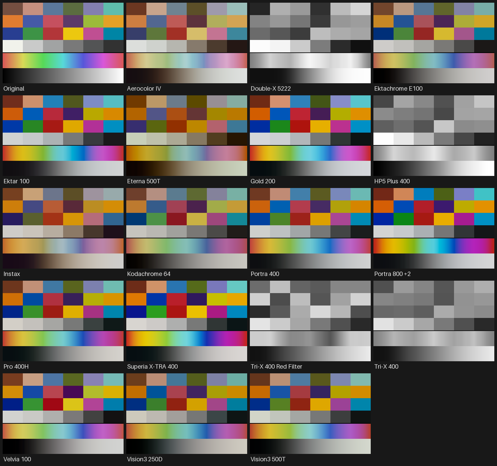

# GRKit film looks for Lightroom

This repo turns the film look collection of [GRKit](https://github.com/ahonn/GRKit) into Lightroom and
Camera Raw creative profiles. GRKit fits its 18 film looks for Ricoh GR cameras from film simulation
LUTs. This repo rebakes the same film and print recipes for Lightroom's color pipeline and embeds
each one in a `.xmp` profile you can import.

Unofficial. Not affiliated with GRKit, Adobe, Kodak, Fujifilm, or Ilford.



The chart is synthetic (ColorChecker reference colors, a hue sweep and a gray ramp) and the tables are
decoded from the shipped profiles at Amount 100. Lightroom applies them to raw-processed data, so treat
this as a guide to each look rather than an exact preview.

## Install

Download `grkit-lightroom-profiles.zip` from the [latest release](../../releases/latest), then:

- Lightroom Classic: Develop > Profile Browser > "+" > Import Profiles, and select the zip.
- Lightroom (desktop): File > Import Profiles & Presets.
- Camera Raw: Presets panel > "..." > Import Profiles & Presets.

The profiles appear in three groups: "Film (spektrafilm)", "Film (Spectral Film LUT)" and "Film (t3mujinpack)".

## Use

- Set exposure first. Every profile maps 18% gray to 18% gray, so a well-exposed image keeps its brightness.
- A profile replaces your current one; Lightroom applies one profile at a time.
- The Amount slider runs from 0 to 200. Start near 50 to 70, because the film contrast is strong.
- The B&W looks (Tri-X 400, Tri-X 400 Red Filter, Double-X 5222, HP5 Plus 400) output neutral gray
  but leave Treatment set to Color.
- There is no grain or halation. Use Lightroom's Effects > Grain.

## Looks

| Profile | GRKit effect | Simulation | License of the look |
|---|---|---|---|
| Portra 400 | portra-400-endura-v1 | spektrafilm | CC BY-SA 4.0, no resale |
| Gold 200 | gold-200-premier-v1 | spektrafilm | CC BY-SA 4.0, no resale |
| Ektar 100 | ektar-100-edge-v1 | spektrafilm | CC BY-SA 4.0, no resale |
| Pro 400H | pro-400h-crystal-v1 | spektrafilm | CC BY-SA 4.0, no resale |
| Superia X-TRA 400 | xtra-400-crystal-v1 | spektrafilm | CC BY-SA 4.0, no resale |
| Vision3 250D | vision3-250d-2383-v1 | spektrafilm | CC BY-SA 4.0, no resale |
| Vision3 500T | vision3-500t-supra-v1 | spektrafilm | CC BY-SA 4.0, no resale |
| Portra 800 +2 | portra-800-push2-v1 | spektrafilm | CC BY-SA 4.0, no resale |
| Kodachrome 64 | kodachrome-64-v1 | spektrafilm | CC BY-SA 4.0, no resale |
| Velvia 100 | velvia-100-v1 | spektrafilm | CC BY-SA 4.0, no resale |
| Ektachrome E100 | ektachrome-e100-v1 | spektrafilm | CC BY-SA 4.0, no resale |
| Tri-X 400 | trix-400-mono-v1 | Spectral Film LUT | MIT |
| Tri-X 400 Red Filter | red-filter-mono-v1 | Spectral Film LUT | MIT |
| Aerocolor IV | aerocolor-iv-v1 | Spectral Film LUT | MIT |
| Eterna 500T | eterna-500t-3523xd-v1 | Spectral Film LUT | MIT |
| Instax | instax-v1 | Spectral Film LUT | MIT |
| Double-X 5222 | double-x-5222-mono-v1 | Spectral Film LUT | MIT |
| HP5 Plus 400 | hp5-plus-400-mono-v1 | t3mujinpack | MIT |

## How it works

- [spektrafilm](https://github.com/andreavolpato/spektrafilm) and
  [Spectral Film LUT](https://github.com/JanLohse/spectral_film_lut) bake each GRKit recipe as a 32³ LUT
  with ProPhoto RGB input instead of GRKit's V-Log. HP5 Plus 400 comes from a
  [t3mujinpack](https://github.com/t3mujin/t3mujinpack) HaldCLUT, converted from sRGB to ProPhoto.
- Each look gets an exposure offset so 18% gray maps to 18% gray.
- `scripts/cube2profile.py` stores the LUT as a Camera Raw RGB table (ProPhoto, gamma 1.8, Amount 0 to 200%),
  following the table format in the Adobe DNG SDK (`dng_big_table.cpp`).

## Building

Requires macOS or Linux with [uv](https://docs.astral.sh/uv/), git and curl. uv installs Python 3.13 if needed.

```sh
./build.sh      # builds dist/grkit-lightroom-profiles.zip and docs/looks.png
```

| File | Purpose |
|---|---|
| `pins.env` | The GRKit commit everything is built from. |
| `build.sh` | Fetches pinned sources, bakes, writes profiles, checks mid gray, renders the contact sheet, zips. |
| `update.sh` | Reports GRKit changes since the pin; `--apply` bumps the pin and rebuilds. |
| `release.sh` | Publishes the zip as a GitHub Release of the current commit. |
| `scripts/bake_sf_pp.py`, `bake_sfl_pp.py` | GRKit's bake scripts, adapted for ProPhoto in and out, 32³. |
| `scripts/bake_hp5_pp.py` | Converts the HP5 HaldCLUT to a ProPhoto LUT with gray-matched exposure. |
| `scripts/make_profiles.py` | Names, groups and wraps every LUT, then decodes each profile to check it. |
| `scripts/cube2profile.py` | Profile writer and reader. |
| `scripts/grkit_sync.py` | Reads library pins from GRKit's manifest and checks our recipes against GRKit's. |
| `scripts/check_gray.py` | Fails the build if any look moves 18% gray by more than 0.25 stops. |
| `scripts/calibrate.py` | Finds the exposure offset that maps 18% gray to 18% gray for one look. |
| `scripts/contact_sheet.py` | Renders `docs/looks.png`. |
| `scripts/package.py` | Writes the zip with a README and license files. |

The same machine produces byte-identical zips from the same pins. Other platforms can differ in the last
bits of floating-point output.

## Updating

GRKit owns the film recipes (`effects/NOTICE.md`, `effects/sources/`). Its `effects/sources/manifest.json`
pins the spektrafilm, Spectral Film LUT and t3mujinpack commits, so this repo pins only GRKit.
A weekly GitHub Action runs `./update.sh` and opens an issue when GRKit's effects change.

1. `./update.sh` shows what changed in GRKit and whether its recipes and look list still match ours.
2. If the check fails, port the change into `scripts/bake_*_pp.py`, and into `NAMES` in `make_profiles.py`
   for a new look.
3. `./update.sh --apply` bumps `pins.env` and rebuilds. Venvs reinstall when a library pin changes.
4. If `check_gray.py` fails, rerun `scripts/calibrate.py` for the flagged looks and update the offsets in `build.sh`.
5. Commit `pins.env` and `docs/looks.png`, push, then `./release.sh`.

## Known upstream issues (spektrafilm 0.3.4)

- `spektrafilm-lut build --stops-above-gray` has no effect: argparse stores `stops_above_gray`, but `cli.py`
  reads `stops_above_midgray`. `bake_sf_pp.py` passes the value through `--from spec.toml` instead.
- With ProPhoto input and no exposure set, mid gray renders about 1.5 stops bright.
  `stops_above_midgray = 2.47` (gain 1.0) corrects it.

## License

- Code: MIT (see `LICENSE`). The bake scripts are adapted from GRKit, MIT, Copyright (c) 2026 ahonn
  (`licenses/GRKIT_LICENSE.txt`). The profile table format follows the Adobe DNG SDK, used under the
  DNG SDK License; this product includes DNG technology under license by Adobe.
- Profiles carry the license of the look they derive from, and the release zip includes these notices:
  - spektrafilm looks: CC BY-SA 4.0, Andrea Volpato, plus the spektrafilm LUT terms (use and share, no resale).
    See `licenses/SPEKTRAFILM_LICENSE.txt`.
  - Spectral Film LUT looks: MIT, Jan Lohse (`licenses/SPECTRAL_FILM_LUT_LICENSE.txt`).
  - HP5 Plus 400: MIT, João Almeida (`licenses/T3MUJINPACK_LICENSE.txt`).

Film, paper and filter names identify the simulated materials and may be trademarks of their owners.
The looks are simulations, not measured equivalents of the products.
